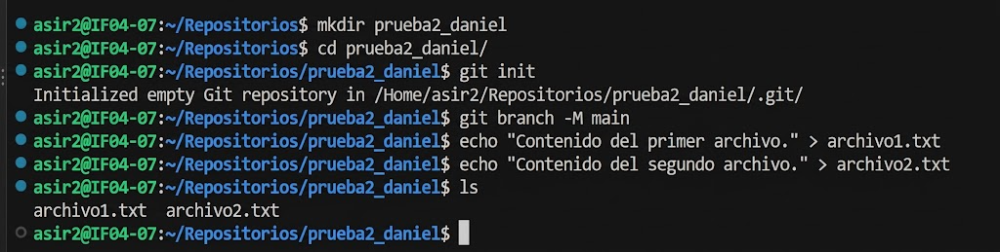
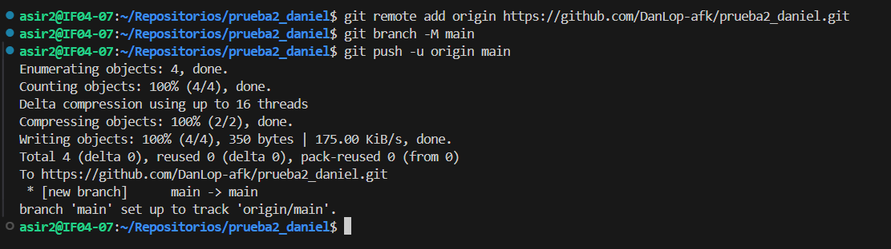
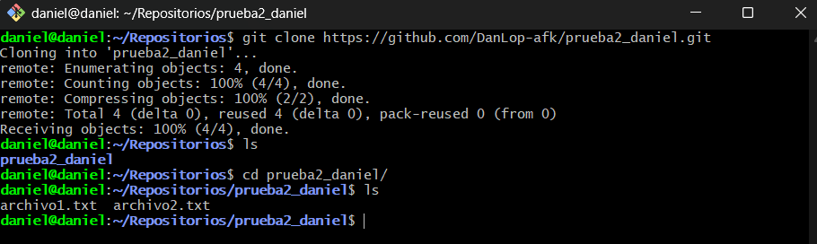
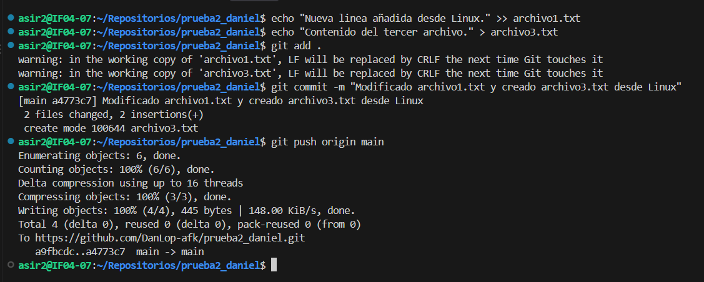
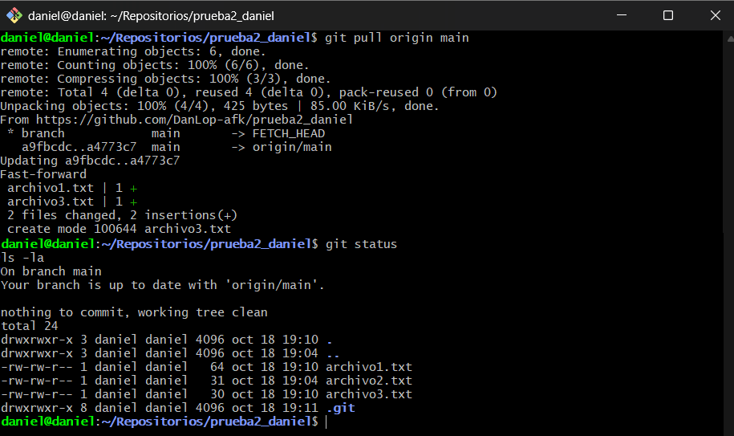

# Paso 1: Creación e inicialización del repositorio local
En primer lugar, abrí mi terminal dentro del VSCode y me ubiqué dentro de la carpeta **Repositorios**. Allí creé el directorio **prueba2_daniel**, accedí a él e inicialicé el repositorio local con **git init**. A continuación, configuré la rama principal como **main** y creé dos archivos de texto (**archivo1.txt** y **archivo2.txt**) utilizando el comando **echo**. Por último, listé el contenido del directorio con **ls** para verificar que ambos ficheros se habían generado correctamente.

# Paso 2: Vinculación con GitHub y primer push
A continuación, creé un repositorio vacío en GitHub llamado **prueba2_daniel**. Luego, vinculé mi repositorio local con el repositorio remoto mediante el comando **git remote add origin [https://github.com/DanLop-afk/prueba2_daniel.git]** y subí la rama **main** a GitHub utilizando **git push -u origin main**.

# Paso 3: Clonación del repositorio en la máquina virtual Linux
Me conecté a mi máquina virtual Linux y me posicioné en la carpeta **Repositorios**. Desde allí, cloné el repositorio remoto ejecutando **git clone [https://github.com/DanLop-afk/prueba2_daniel.git]**. Después, accedí al directorio **prueba2_daniel** y ejecuté **ls** para comprobar que **archivo1.txt** y **archivo2.txt** se habían clonado correctamente.

# Paso 4: Modificación y subida de cambios desde el entorno local
Desde mi entorno local modifiqué **archivo1.txt** agregándole una nueva línea de texto y creé un nuevo archivo llamado **archivo3.txt**. Añadí las modificaciones al área de preparación con **git add** ., guardé los cambios con el mensaje de commit **"Modificado archivo1.txt y creado archivo3.txt desde Linux"**, y finalmente subí los cambios al repositorio remoto ejecutando **git push origin main**.

# Paso 5: Actualización de la versión local del repositorio en la MV Linux
Por último, regresé a mi otro entorno local y ejecuté **git pull origin main** para descargar e integrar las actualizaciones realizadas. Finalmente, verifiqué el estado del repositorio con **git status** y listé el contenido detallado mediante **ls -la**, confirmando que los cambios y el nuevo archivo **archivo3.txt** estaban completamente al día.

