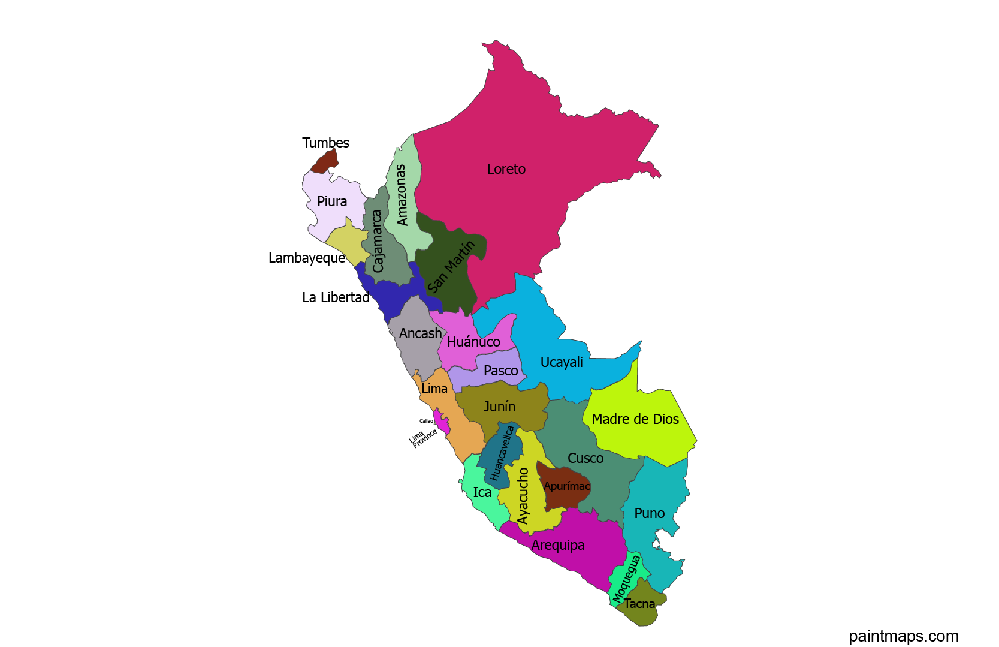

# Ejercicio 2: Introducción a Markdown

## Demostración de elementos de sintaxis

En este párrafo de prueba estamos aprendiendo a dar formato al texto. Podemos resaltar palabras en **negrita**, colocar otras frases en *cursiva* para dar énfasis y mostrar elementos como `git status` redactados directamente en código.

---

```bash
# Ejemplo de un bloque de código en bash
git add .
git commit -m "Añadidos los cambios del ejercicio 2"
git push origin main
```
---
Se crea utilizando números seguidos de un punto (`1.`, `2.`, `3.`):
```markdown
1. Esto
2. Esta
3. Ordenado
```
---
Lista Desordenada
* Linux
* Windows
* GitHub
---

---

[Perfil: DanLop-afk](/DanLop-afk/README.md)

---



---

| Herramienta | Tipo | Entorno principal |
| :--- | :--- | :--- |
| Git | Control de versiones | Terminal / CLI |
| GitHub | Plataforma en la nube | Web |
| Windows | Sistema operativo | Grafico|