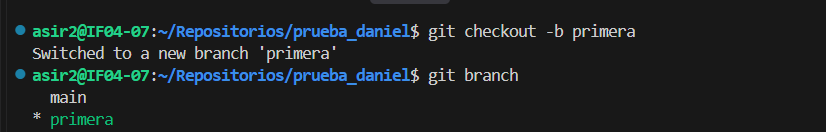
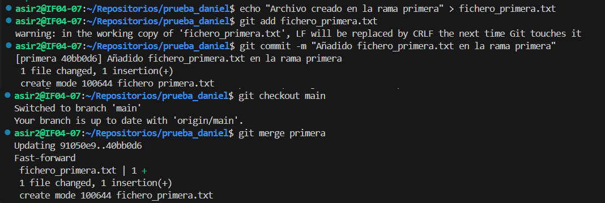
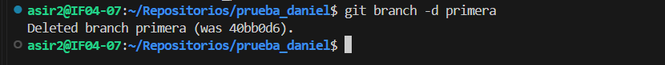
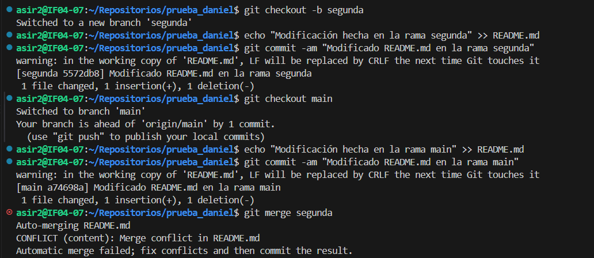
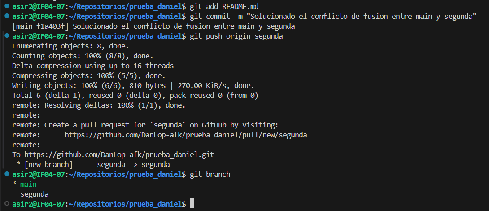

# Creación de la rama "primera" y comprobación
Para comenzar con este ejercicio, me situé en mi repositorio local y creé una nueva rama llamada `primera` utilizando el comando `git checkout -b primera`, lo que me permitió crearla y cambiarme a ella de manera simultánea. A continuación, ejecuté `git branch` para comprobar que me encontraba trabajando dentro de dicha rama, tal como se muestra en la siguiente captura:

# Creación de un nuevo fichero, fusión y ausencia de conflictos
Dentro de la `rama primera`, creé un nuevo archivo de texto llamado `fichero_primera.txt` mediante un comando `echo`. Después, añadí el fichero al área de preparación con `git add` y registré los cambios con un commit.

Posteriormente, me cambié de vuelta a la rama principal ejecutando `git checkout main` y realicé la fusión de la rama `primera` mediante `git merge primera`. No se produjo ningún conflicto durante este proceso debido a que el archivo era completamente nuevo y no existía una versión previa modificada de forma concurrente en la `rama main`:

# Borrado de la rama "primera"
Una vez realizada la fusión y comprobado que los cambios se habían integrado de forma limpia en la rama principal, procedí a eliminar la rama `primera` ejecutando el comando de borrado local `git branch -d primera`:

# Creación de la rama "segunda" y generación del conflicto
Para el siguiente apartado, creé y me cambié a una nueva rama llamada `segunda` con `git checkout -b segunda`. Modifiqué el archivo `README.md` añadiendo una línea de texto y guardé los cambios con un commit.

Luego, regresé a la rama `main` y modifiqué exactamente la misma línea del fichero `README.md` con un texto diferente, realizando otro commit. Al intentar fusionar la rama `segunda` en `main` mediante `git merge segunda`, el sistema detectó que se había alterado la misma zona del archivo en dos ramas distintas, generando un conflicto de fusión automático:

# Resolución del conflicto y sincronización remota de la rama
Para solucionar el conflicto, abrí el archivo `README.md`, eliminé las marcas de conflicto (`<<<<<<<, =======, >>>>>>>`) y dejé el texto definitivo tal como deseaba. A continuación, añadí el fichero corregido al área de preparación con `git add README`.md y registré la solución mediante un commit.

Finalmente, subí la rama `segunda` al repositorio remoto en GitHub ejecutando `git push origin segunda`, y comprobé el estado local con `git branch`:

