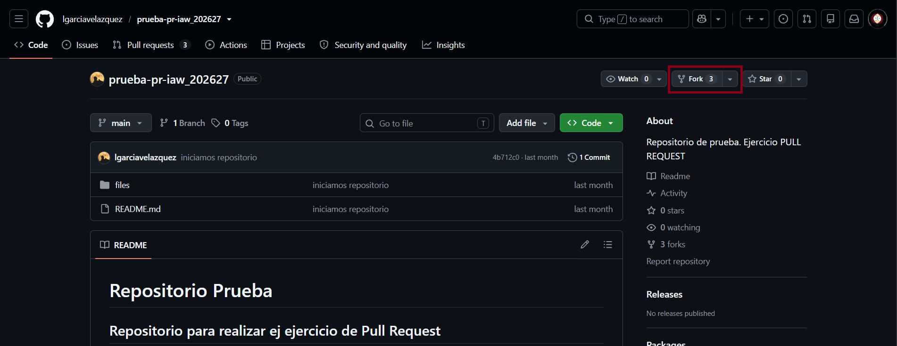
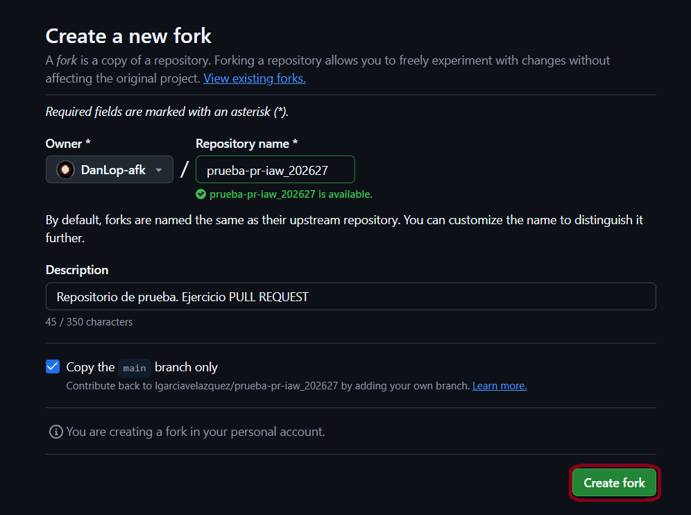
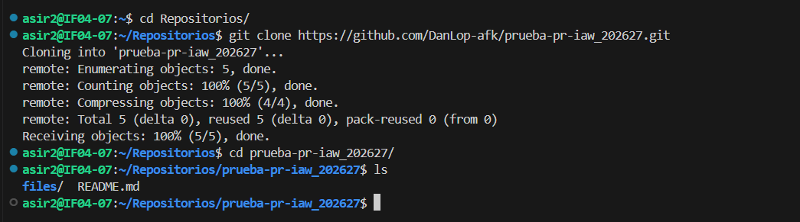
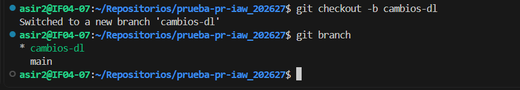
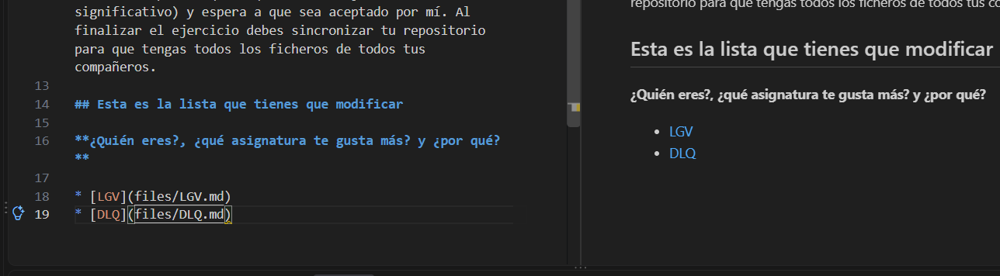
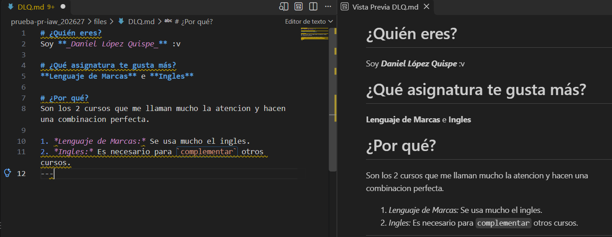
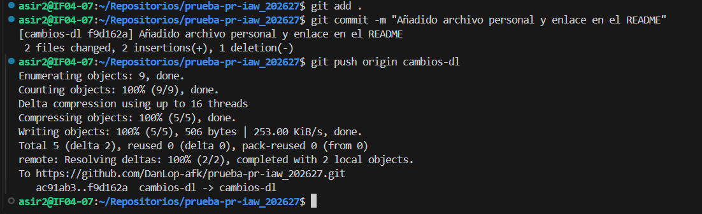
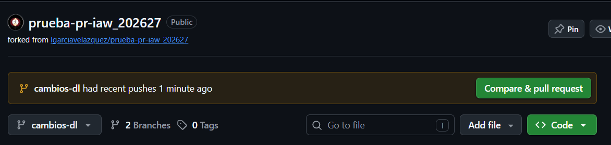
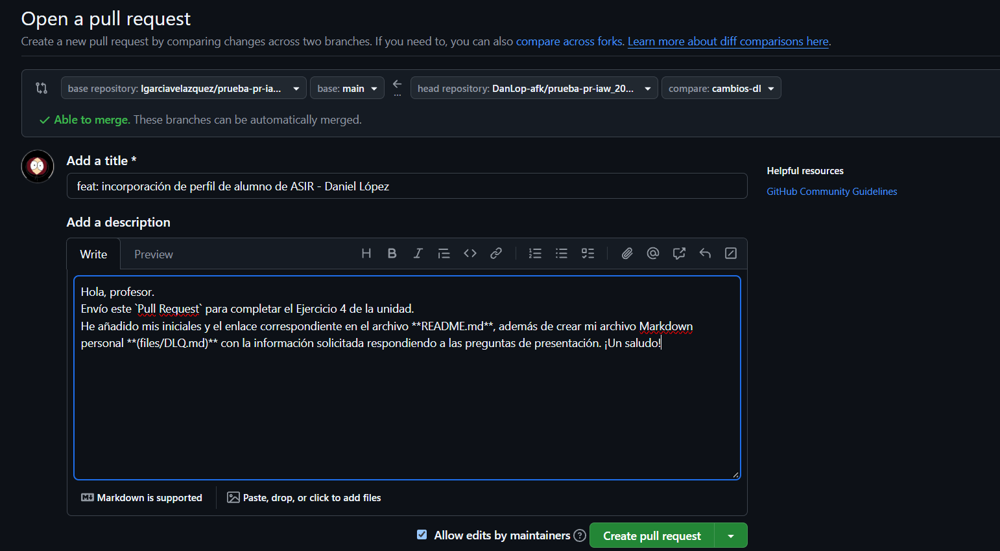
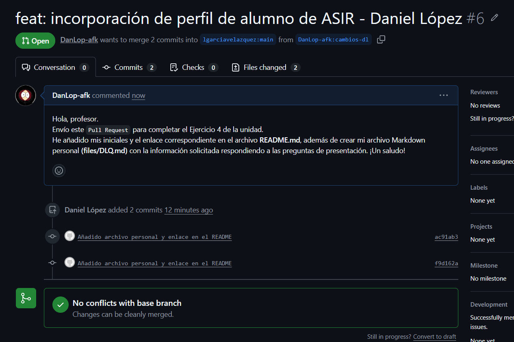

# Documentación del Ejercicio 4: Colaboración en proyectos con Pull Request (PR)

### Paso 1: Localizar el repositorio original y hacer un Fork
Para colaborar en el proyecto de software libre de la asignatura, accedí en GitHub al repositorio original del profesor `(lgarciavelazquez/prueba-pr-iaw_202627)` y utilicé la opción Fork (situada en la esquina superior derecha) para crear una copia del proyecto en mi cuenta personal.



---

### Paso 2: Confirmar la creación del Fork en la cuenta personal
A continuación, configuré los detalles del nuevo repositorio en mi cuenta `(DanLop-afk/prueba-pr-iaw_202627)`, manteniendo la descripción original, y pulsé el botón Create fork para generar mi copia remota personal.



---

### Paso 3: Clonar el repositorio bifurcado en la máquina virtual Linux
Accedí a la terminal de mi máquina virtual Debian 12, navegué hasta la carpeta Repositorios y cloné mi Fork ejecutando `git clone [https://github.com/DanLop-afk/prueba-pr-iaw_202627.git]`. Después, entré al directorio del proyecto y listé su contenido inicial mediante `ls`.



---

### Paso 4: Crear una nueva rama para realizar los cambios
Siguiendo las buenas prácticas de desarrollo en Git, creé una rama específica de trabajo llamada `cambios-dl` ejecutando `git checkout -b cambios-dl`. Comprobé que me encontraba en ella utilizando la orden `git branch`.



---

### Paso 5: Modificar el fichero README.md e incluir el enlace a las iniciales
Abrí el editor para modificar el fichero `README.md` del directorio raíz, añadiendo una nueva entrada a la lista con mis iniciales `DLQ` apuntando hacia la ruta del archivo individual que crearía en el siguiente paso `(files/DLQ.md)`.



---

### Paso 6: Crear el fichero personal en la carpeta files/
En el directorio `files/`, creé mi archivo personal de presentación llamado `DLQ.md`. Redacté las respuestas a las tres preguntas solicitadas (¿Quién eres?, ¿Qué asignatura te gusta más? y ¿Por qué?), aplicando más de 5 marcas distintas de sintaxis Markdown (títulos `#`, negritas `**`, cursivas `*`, código en línea `´`  y listas ordenadas `1.`).



---

### Paso 7: Confirmar los cambios localmente y realizar el Push a GitHub
Añadí todos los cambios realizados al área de preparación mediante `git add .`, guardé el commit con un mensaje descriptivo (`"Añadido archivo personal y enlace en el README`") y subí la nueva rama a mi repositorio remoto de GitHub con `git push origin cambios-dl`.



---

### Paso 8: Iniciar la comparación para el Pull Request en GitHub
Entré a la página web de mi repositorio en GitHub `(DanLop-afk/prueba-pr-iaw_202627)`. Al haber subido una rama reciente, la plataforma mostró automáticamente la barra de sugerencia amarilla para crear la contribución. Pulsé sobre el botón Compare & pull request.



---

### Paso 9: Redactar el título y la descripción del Pull Request
En el formulario de envío, establecí un título claro y significativo `(feat: incorporación de perfil de alumno de ASIR - Daniel López)` y redacté una descripción educada especificando los archivos añadidos y modificados. Finalmente, hice clic en el botón verde **Create pull request**.



---

### Paso 10: Estado del Pull Request abierto (A la espera de revisión)
Se abrió con éxito el Pull Request #6 en el repositorio del profesor `(lgarciavelazquez/prueba-pr-iaw_202627)`. La plataforma confirmó que los cambios no presentaban conflictos con la rama principal `(No conflicts with base branch)`, quedando registrada la petición de fusión a la espera de ser revisada y aceptada por el propietario del repositorio.



---

### Paso 11: Aceptación del Pull Request y Sincronización final (Paso pendiente)
Una vez que el propietario revise y acepte el Pull Request integrando los cambios en la rama principal remota `(main)`, llevaré a cabo la sincronización local ejecutando los siguientes comandos desde la terminal para obtener todas las aportaciones de los demás compañeros:

```Bash
# Cambiar a la rama principal local
git checkout main

# Configurar el repositorio original como upstream (si no se ha añadido previamente)
git remote add upstream https://github.com/lgarciavelazquez/prueba-pr-iaw_202627.git

# Traer los cambios actualizados del repositorio original
git fetch upstream
git merge upstream/main

# Sincronizar la rama main de mi Fork en GitHub
git push origin main
```
