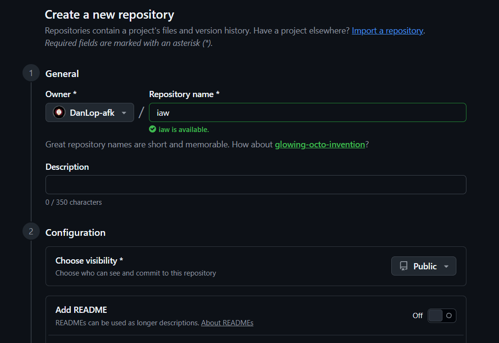
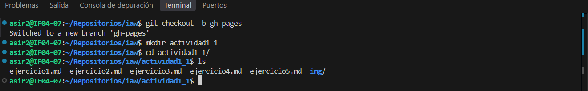
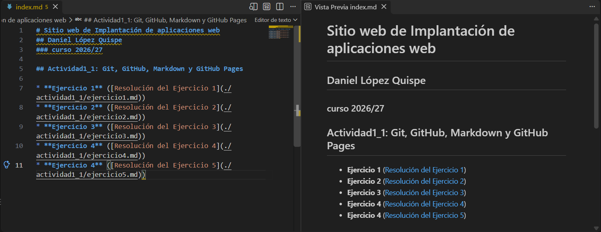
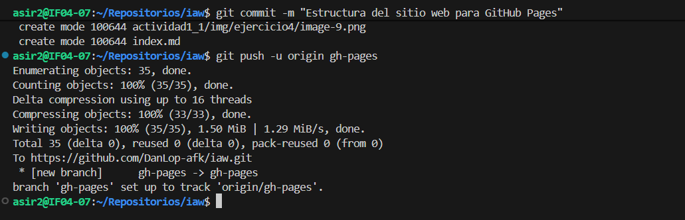
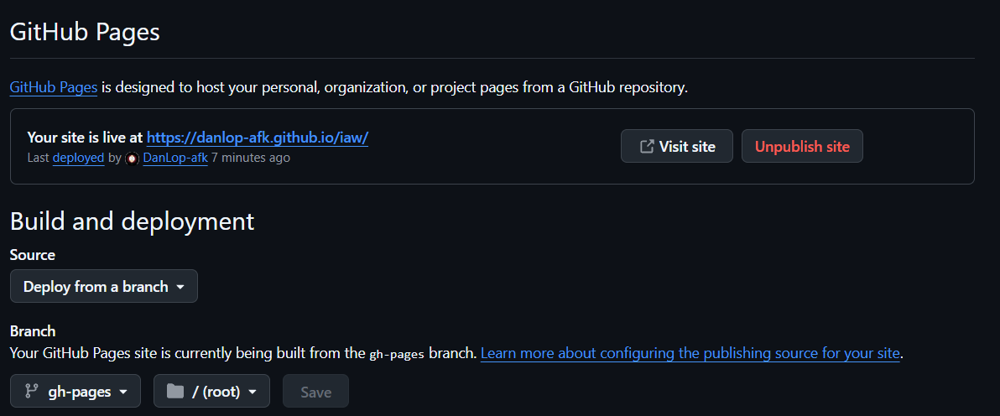

# Documentación del Ejercicio 5: Creación de un sitio con GitHub Pages

### Paso 1: Crear el repositorio del proyecto en GitHub
Para comenzar a desplegar el sitio estático del proyecto, accedí a mi cuenta de GitHub `(DanLop-afk)` y creé un nuevo repositorio público llamado `iaw`. Me aseguré de dejar desmarcada la opción de añadir un archivo `README.md` inicial para partir de un repositorio completamente limpio.

---

### Paso 2: Crear la rama gh-pages y estructurar las carpetas del sitio
En la terminal de mi máquina virtual, creé y me cambié a la rama de publicación gh-pages mediante la orden git checkout -b gh-pages. A continuación, creé el directorio actividad1_1 junto con la subcarpeta img/ (mkdir -p actividad1_1/img) para organizar y almacenar los ficheros .md y las imágenes de los ejercicios del 1 al 5 en las rutas requeridas.

---

### Paso 3: Crear el archivo de inicio e índice de contenidos (index.md)
En el directorio raíz del proyecto, redacté el fichero index.md que actúa como la página de inicio principal del sitio web. Incluí los encabezados con mis datos personales y del curso, así como la lista con los enlaces Markdown que apuntan a la resolución de cada uno de los ejercicios dentro de la carpeta actividad1_1/.

---

### Paso 4: Realizar el commit y subir los cambios a la rama gh-pages
Una vez organizada toda la estructura y comprobados los enlaces, añadí los ficheros al área de preparación con git add ., guardé el cambio con un mensaje descriptivo mediante git commit -m "Estructura del sitio web para GitHub Pages" y publiqué la rama en el repositorio remoto con git push -u origin gh-pages.

---

### Paso 5: Activación y publicación del sitio web en GitHub Pages
Accedí a la sección de Settings > Pages en el repositorio iaw en GitHub. En el apartado Build and deployment, seleccioné la opción Deploy from a branch, configurando como origen la rama gh-pages y la carpeta raíz / (root). Tras guardar los cambios, la plataforma compiló el sitio y confirmó que la web ya se encontraba pública y accesible de forma permanente en la URL: [https://danlop-afk.github.io/iaw/].

---
